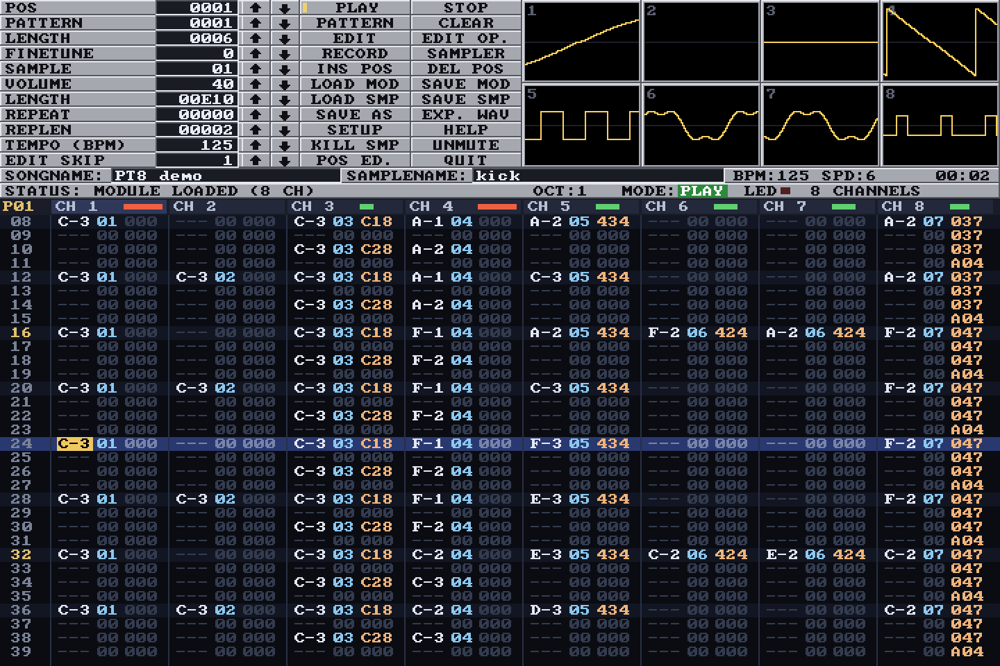
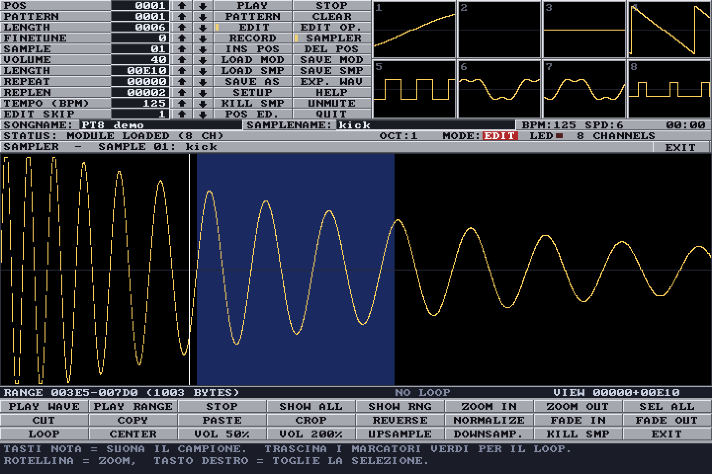

# PT8 – retro tracker per Windows

[](https://github.com/ivan0174-hue/retro-tracker-for-windows/actions/workflows/build.yml)

**PT8** è un tracker musicale per Windows con l'aspetto e i comandi di
**ProTracker 2.3D per PC**, ma con **8 canali** invece di 4.
È un unico eseguibile di circa 200 KB, scritto in C, senza librerie esterne
e senza installazione.



## Download

Scarica lo zip dalla pagina **[Releases](https://github.com/ivan0174-hue/retro-tracker-for-windows/releases/latest)**,
estrailo e fai doppio clic su `PT8.exe`. Funziona su Windows 7, 8, 10 e 11 a 64 bit.

Il programma non è firmato digitalmente: la prima volta Windows può mostrare
"Windows ha protetto il PC". Clicca su **Ulteriori informazioni** e poi su **Esegui comunque**.

Per una prima prova apri `demo8.mod` (incluso nello zip e in [`examples/`](examples/))
con **LOAD MOD**, oppure trascinalo nella finestra, e premi **PLAY**.

## Caratteristiche

- **Editor dei pattern a 8 canali** con i tasti di ProTracker: Z S X D C… e Q 2 W 3 E… per le note,
  F1/F2 per l'ottava, Alt destro / Ctrl destro / Shift destro per suonare brano, pattern e registrare.
- **Replayer basato sulla logica di ProTracker 2.3D**, comprese le sue stranezze
  (scambio dei campioni, overflow dell'arpeggio, EFx…). Confrontato con
  [libxmp](https://github.com/libxmp/libxmp) sui 22 moduli di test ProTracker di OpenMPT:
  il flusso del brano coincide su tutti, periodo e volume tick per tick su 15;
  restano differenze in alcuni casi limite (note delay, retrigger, arpeggio oltre la tabella).
- **Emulazione di Paula**: filtri A500/A1200, filtro LED (E0x), separazione stereo regolabile,
  interpolazione opzionale.
- **8 oscilloscopi**: clic sul canale = mute, tasto destro = solo.
- **Sampler**: forma d'onda con zoom, selezione, loop trascinabile, taglia/copia/incolla, crop,
  reverse, normalize, fade, upsample/downsample.
- **Edit Op.**: trasposizione di traccia, pattern o brano; taglia/copia/incolla di tracce, pattern ed effetti.
- **Annulla/ripristina** (Ctrl+Z / Ctrl+Y), **editor delle posizioni**, **schermo intero** (Alt+Invio),
  **esportazione WAV**.
- **Help in italiano** dentro il programma (pulsante HELP).



## Formati

| | |
|---|---|
| **Moduli in lettura** | M.K., M!K!, FLT4, 4CHN, 6CHN, 8CHN, FLT8 (Startrekker), OCTA, CD81/CD61 (Octalyser), FA0x (Digital Tracker), TDZx, Soundtracker a 15 campioni |
| **Moduli in scrittura** | M.K. se i canali 5–8 sono vuoti (suona anche su ProTracker/Amiga), altrimenti 8CHN (OpenMPT, MilkyTracker, FastTracker 2, XMPlay, VLC…) |
| **Campioni** | WAV (8/16/24/32 bit, float, mono/stereo, con loop), IFF 8SVX, AIFF/AIFC, RAW 8 bit; salvataggio in WAV |
| **Esportazione** | WAV 48 kHz stereo 16 bit |

## Tasti principali

| Tasto | Funzione |
|---|---|
| Spazio | Stop / attiva-disattiva EDIT |
| Alt destro, F6 | Suona il brano |
| Ctrl destro, F7 | Suona il pattern |
| Shift destro, F8 | Registra |
| F1 / F2 | Ottava bassa / alta |
| Z S X D C V… / Q 2 W 3 E R… | Note |
| 0–9, A–F | Numero di campione ed effetto |
| Tab / Shift+Tab | Canale successivo / precedente |
| F9 F10 F11 F12 | Riga 0 / 16 / 32 / 48 |
| Canc, Backspace, Ins | Cancella, elimina riga sopra, inserisci riga (Shift = tutti i canali) |
| Shift / Alt / Ctrl + F3 F4 F5 | Taglia / copia / incolla traccia / pattern / effetti |
| Ctrl+Z / Ctrl+Y | Annulla / ripristina |
| Ctrl+O / Ctrl+S / Ctrl+L / Ctrl+E | Apri modulo / salva / carica campione / esporta WAV |
| Alt+1…8 | Mute del canale |
| Alt+Invio | Schermo intero |

L'elenco completo, con tutti gli effetti, è nel programma (HELP) e in [`LEGGIMI.txt`](LEGGIMI.txt).

## Se qualcosa non va

A ogni avvio PT8 scrive `PT8.log` accanto all'eseguibile, con le fasi dell'avvio
(o nella cartella temporanea di Windows, se quella cartella non è scrivibile).
Se il programma si chiude per un errore, i dettagli finiscono in `PT8_crash.txt`.
Le impostazioni sono salvate in `PT8.ini`; se l'audio scatta, aumenta `audiobuffer` (per esempio a 1024).

## Compilare dai sorgenti

Serve un compilatore **mingw-w64**. Su Windows il modo più semplice è
[MSYS2](https://www.msys2.org/):

```sh
# nella shell "MSYS2 UCRT64"
pacman -S --needed mingw-w64-ucrt-x86_64-gcc
sh build.sh
```

Su Linux o macOS funziona allo stesso modo con un cross-compilatore
`x86_64-w64-mingw32-gcc`. Il risultato è `build/PT8.exe`.

> **Nota sulle toolchain LLVM ≤ 18.** Se `libmsvcrt.a` è generata da `llvm-dlltool` 18 o precedente,
> `atexit()` richiama se stessa e qualunque programma si blocca all'avvio (era il difetto della 1.0).
> In [`tools/crtfix/`](tools/crtfix/) c'è la correzione. Con gcc di MSYS2 il problema non esiste.

### Test

Il nucleo (replayer, file I/O) e l'interfaccia sono indipendenti da Windows, quindi i test
girano su Linux/macOS con AddressSanitizer:

```sh
make -C tests check
```

- `functest`: inserimento note, annulla/ripristina, copia/incolla, salvataggio M.K./8CHN e ricarica, export WAV
- `monkey`: migliaia di input casuali (tastiera, mouse, sampler)
- `coretest`: verifica di lettura e scrittura dei moduli, rendering in WAV; con
  `make XMP=/percorso/libxmp` confronta la riproduzione con libxmp tick per tick
- `uiharness`: genera screenshot dell'interfaccia senza Windows
- `wdriver.c`: piccolo programma Windows per pilotare PT8 durante i test (Windows o Wine)

A ogni push GitHub Actions compila `PT8.exe` con MSYS2 e lo avvia su Windows per
verificare che la finestra si apra. Esegue anche i test qui sopra su Linux.

## Struttura

```
src/        codice del programma
  main_win32.c  finestra, tastiera/mouse, audio waveOut, dialoghi di Windows
  app.c         interfaccia stile ProTracker (disegnata in un framebuffer 720x480)
  replayer.c    replayer ProTracker 2.3D a 8 canali + mixer Paula
  song.c        caricamento/salvataggio MOD, import/export campioni
res/        icona, manifest, informazioni di versione
tests/      test e strumenti di sviluppo
tools/      generatore del brano demo, correzione per toolchain LLVM
examples/   demo8.mod, brano dimostrativo originale a 8 canali
```

## Crediti

- Ispirato a ProTracker per Amiga e al suo porting per PC. PT8 è un progetto indipendente
  e non contiene codice di ProTracker.
- Font 8x8 di Daniel Hepper ([font8x8](https://github.com/dhepper/font8x8), pubblico dominio).
- Omaggio a tutta la scena Amiga.
